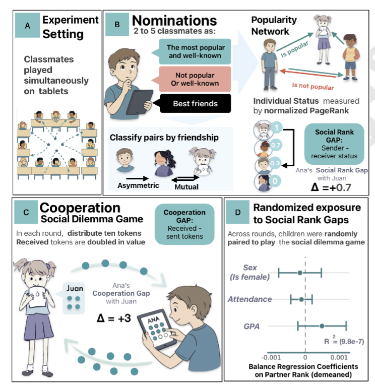

This companion website presents the results reported in the article and its Supporting Information and links to the data, R scripts, and notebooks needed to reproduce them.

## Abstract

::: {.study-intro}
::: {.study-abstract}
Human interaction is often structured by social hierarchy, generating systematic asymmetries in attention, influence, and resource exchange. While such hierarchies can facilitate coordination, they also produce persistent inequalities. Although hierarchy-related asymmetries are widely documented, less is known about how they are shaped by voluntary social ties in everyday cooperative behavior. Here, we examine how social status and friendship jointly structure cooperation using a large-scale social-dilemma experiment embedded in real classroom networks. In the experiment, 859 children (ages 9–12) in 45 elementary school classrooms were paired with different classmates across rounds according to a randomized round-robin partner schedule that prevents endogenous partner selection. Analyzing 17,804 directed allocation decisions, we show that cooperation is, on average, skewed toward higher-status peers: children allocate more resources to higher-ranked classmates and receive less in return. However, this pattern is not uniform. Within mutually recognized friendships, status-based asymmetries in cooperation are strongly attenuated, yielding more balanced and generous exchanges across rank positions. When friendship recognition is unreciprocated, one-sided friendship nominations show descriptively different patterns by nomination direction: downward recognition from higher- to lower-status peers is closer to the balanced exchange observed among mutual friends, whereas upward recognition resembles hierarchy-associated asymmetries. Together, these findings show that the expression of hierarchy in cooperation is conditional on relational context rather than structurally fixed. More broadly, this work provides a scalable experimental approach for studying how informal social ties modulate the behavioral consequences of hierarchy in human groups.
:::

::: {.study-figure}
{fig-alt="Four panels illustrating the classroom experiment, peer nominations, the token game, and the partner-rank balance check."}
:::
:::

## 1. Explore the results on this website

Browse the rendered notebooks for [Main Results](main/index.qmd) and [Supporting Information](si/index.qmd). Each notebook presents the analysis alongside its R code, tables, and figures.

::: {.small .text-body-secondary}
For an overview of the replication package, see the [repository README](https://github.com/melanieoyarzun/patio-en-red/tree/main#readme).
:::

## Other ways to explore the results

### 2. Explore the notebooks on GitHub

Use the [notebook index](https://github.com/melanieoyarzun/patio-en-red/blob/main/notebooks/README.md) to open the Jupyter notebooks with their saved outputs. Each notebook has a corresponding Quarto source in the same folder.

### 3. Work locally

[Clone and reproduce](https://github.com/melanieoyarzun/patio-en-red/tree/main#clone-and-reproduce) the results using the R scripts or notebooks.
